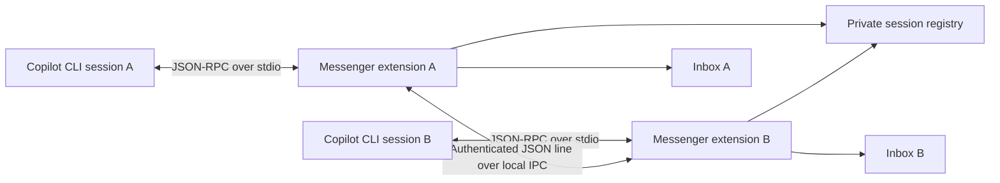

# Architecture

## Overview

Every Copilot CLI session starts an independent extension process. The process joins its owning
session through the Copilot extension SDK and starts a local IPC endpoint.

The Copilot CLI controls extension lifecycle. Session Messenger does not create or control Copilot
sessions; it only provides a communication channel among sessions that already loaded the plugin.

## Components

### Extension adapter

`extensions/session-messenger/extension.mjs` integrates with Copilot CLI:

- registers the four agent tools;
- displays incoming messages with `session.log()`;
- queues actionable messages with `session.sendAndWait()`;
- relays the receiving agent's final response to the originating session;
- serializes incoming deliveries so concurrent messages retain a deterministic order;
- closes the local peer when the Copilot session ends.

### Transport core

`extensions/session-messenger/messenger-core.mjs` is independent of the Copilot SDK and handles:

- session registration and discovery;
- aliases;
- Unix socket or Windows named-pipe transport;
- per-session bearer-token authentication;
- message validation and size limits;
- inbox persistence and rotation;
- heartbeat and stale-entry cleanup.

Keeping the transport independent makes it testable with ordinary Node.js processes.

## Session lifecycle

1. The extension reads `SESSION_ID`, which Copilot CLI provides to extension processes.
2. It joins the foreground session with `joinSession()`.
3. The transport creates a random 256-bit token and an IPC endpoint.
4. It writes a private registry entry and refreshes it every 10 seconds.
5. Other sessions read the registry to discover the peer.
6. On shutdown, the endpoint and registry entry are removed.
7. Entries older than 45 seconds are removed during discovery, even if their recorded PID was
   reused by an unrelated process.

## Address resolution

Targets are resolved in this order:

1. exact session ID;
2. exact alias, case-insensitive;
3. unique session-ID prefix;
4. unique alias prefix.

Ambiguous prefixes fail explicitly and return the matching aliases.

## Delivery flow

1. The sender resolves the target from the private registry.
2. It connects to the target endpoint and submits one newline-delimited JSON request.
3. The receiver validates protocol version, destination, token, delivery mode and message size.
4. The message is appended to the target inbox.
5. The receiver immediately returns an acknowledgement containing message ID and receipt time.
6. The extension displays the message and optionally queues it into the receiving agent.
7. When a reply was requested, the final assistant response is sent back as a `reply` message
   correlated through `replyToMessageId`.

The initial send reports success after the target persists and accepts the message. Agent work is
asynchronous; its result arrives later as a separate inbox and timeline event. Replies use
`notify` delivery and cannot request another automatic reply, preventing response loops.
