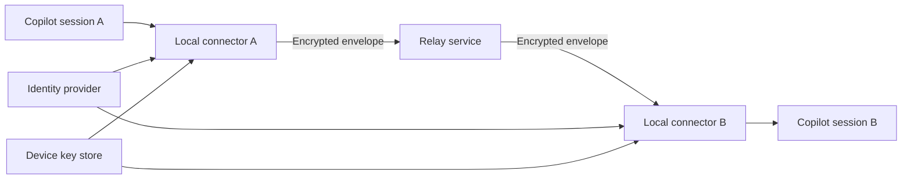

# Remote relay roadmap

Local IPC cannot reach Copilot sessions on another computer or in a hosted environment. Supporting
that scenario requires a separate relay service rather than exposing local sockets.

## Required properties

A production relay should provide:

- device registration tied to the user's GitHub or enterprise identity;
- short-lived access tokens;
- end-to-end encryption so the relay cannot read message content;
- per-device signing keys and verified sender identity;
- explicit device and session revocation;
- replay protection and monotonic message sequence numbers;
- offline queues with expiry and bounded storage;
- delivery and read acknowledgements;
- rate limits, abuse protection and audit events;
- enterprise policy controls for local-to-cloud communication.

## Suggested architecture



The existing local extension should remain responsible for Copilot integration. A separate
connector module would choose local IPC or relay delivery based on the target address.

## Envelope sketch

```json
{
  "version": 1,
  "messageId": "UUID",
  "senderDeviceId": "device UUID",
  "senderSessionId": "session UUID",
  "recipientDeviceId": "device UUID",
  "recipientSessionId": "session UUID",
  "createdAt": "ISO-8601 timestamp",
  "expiresAt": "ISO-8601 timestamp",
  "nonce": "base64",
  "ciphertext": "base64",
  "signature": "base64"
}
```

The relay should route opaque envelopes and never receive plaintext or long-lived device private
keys.

## Recommended delivery phases

1. Device enrollment and session presence.
2. Signed, encrypted online delivery.
3. Offline queue with expiry.
4. Enterprise policy and audit integration.
5. Multi-user teams with explicit invitations and role-based authorization.

The local MVP should not claim remote compatibility until these controls exist and have undergone a
dedicated security review.
